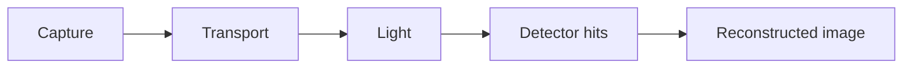

# Human review and input

Use at specification approval, scientific acceptance, a material change, or a
blocking request for input. Native orchestration should show the brief directly
in chat; a file link or a state dump alone is not a handoff. Keep the full
specification, provenance, logs and detailed review in linked artifacts.

## Decision brief

Aim for 150-250 words for a substantive review; a simple missing-input question
can be a few lines. Use familiar language, short headings when helpful, bold
decision-critical points, and at most one compact comparison/evidence table.
Expand only when needed to explain a material uncertainty or tradeoff.

1. **Status and decision:** say what is complete, what remains, and the single
   decision or input needed now. Distinguish proposed work, verified test results
   and human scientific acceptance.
2. **Recommendation:** give the suggested action and its practical consequence.
   For approval, summarize scope, outputs and how success will be checked; for
   acceptance, summarize findings and the limits of the supported conclusion.
3. **Evidence and limits:** highlight up to three decision-critical facts,
   assumptions or unresolved issues. Put units, uncertainty and provenance next
   to quantitative claims. Preserve failures, null results and unknowns.
4. **Your response:** give a natural-language reply, such as "Approve
   specification <version> and proceed" or "Accept these results because
   <reason>". Offer "Request changes: ..." as an alternative. The user replies
   in chat; the coordinator records the decision against the actual version/hash.
   A missing detail should be a focused question with a recommended default and
   its consequence, if a defensible default exists.
5. **Details:** link the exact specification, validation report and relevant
   figures. Keep hashes, long command logs, model metadata and file inventories
   in those records unless they affect the decision.

For a revision, lead with what changed, its effect on the conclusion or planned
work, and any remaining concern. Do not repeat the entire planning history.

## Visuals that help a decision

Use one compact visual when it explains the choices or evidence faster than
prose. Use Mermaid for a pipeline or stage diagram, a table for alternatives,
and a graph for actual quantitative results. Label units, uncertainty, sources
and synthetic versus measured data. Never invent data to fill a chart.
For scientific plots intended for export, use standard plotting tools, save the
figure alongside its data, and inspect the rendered artifact. If Mermaid is not
supported, provide a short text flow. Skip visuals for one-step approvals.

Example planning handoff (illustrative, not evidence):

**Status: planning complete; implementation has not started.**

**Recommendation:** approve specification <version> for a reproducible synthetic
demo. It will produce detector events, reconstructed images and a validation
report. Physical calibration is still required before comparison to hardware.

**Check before approving:**
- Scope: synthetic planar geometry and explicitly documented assumptions.
- Verification: analytical controls, deterministic reruns and independent review.
- Main limit: synthetic response parameters do not establish device performance.

**Your response:** "Approve specification <version> and proceed", or
"Request changes: ...". [Full specification](<actual artifact path>)

## Avoid repeated permission requests

| Situation | Action |
| --- | --- |
| Routine computer action inside approved scope | Proceed and verify the result. |
| Tests, bounded repairs or review already authorized | Continue; report meaningful progress. |
| Existing approval matches the unchanged frozen specification | Reuse it; do not re-freeze to request approval again. |
| Missing scientific input | Inspect available sources, then bundle only essential questions. |
| New method, material scope/cost/data exposure or unapproved consequential action | Prepare a concrete choice and ask once. |
| Host permission or runtime setting blocks execution | Explain the exact boundary and smallest required change; continue independent work. |

Do not substitute a scientific approval for an OS permission, bypass a host
rejection, or change security settings to reduce prompts. If automatic approval
review rejects an action and no compliant alternative works, identify the action,
state the reviewer's reason and explain the remaining required approval.
